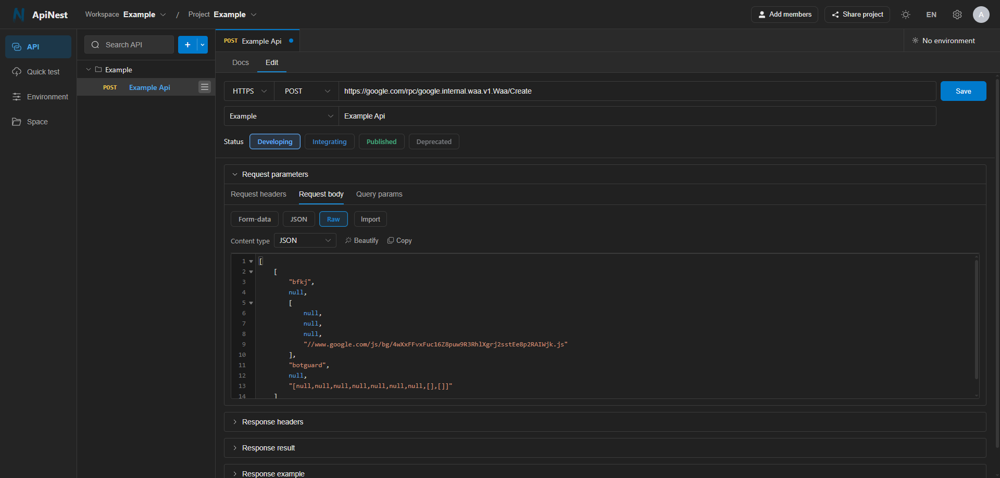
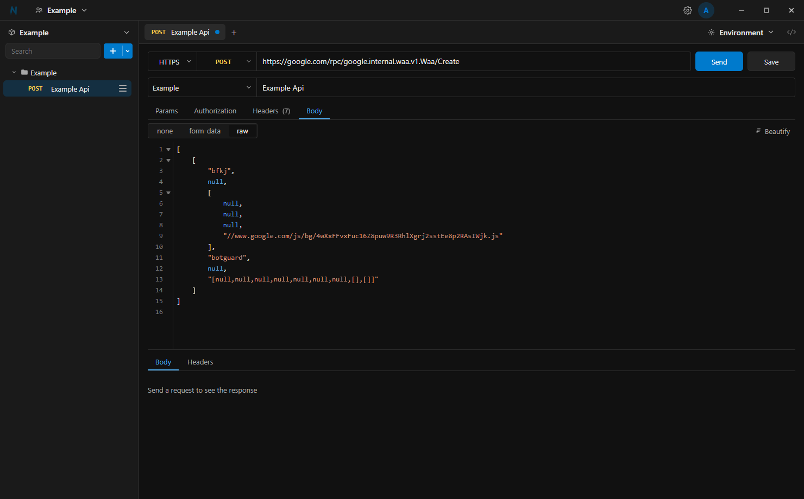

# ApiNest

> Open-source API documentation and collaboration platform

[English](README.md) | [中文](README_zh.md)

**ApiNest** (Apinest) is a self-hosted API collaboration and debugging platform covering API docs, environments, and local requests.

## Highlights

- **Dual-end sync**: Keep Web and Desktop in sync—no need to rewrite docs after local testing
- **Absolute security**: Requests are sent from your machine; secrets and API details need not rely on a third-party cloud
- **Self-hosted control**: Docker-based setup; accounts, permissions, and data stay on your own servers
- **Open interchange**: Import from Postman, OpenAPI, Eolink, YApi, and more; plus native Apinest import/export
- **Team collaboration**: Workspace invites and role-based permissions; share links so guests can view selected APIs without signing in

## Screenshots

<table>
  <tr>
    <th align="center">Web</th>
    <th align="center">Desktop</th>
  </tr>
  <tr>
    <td width="50%" align="center">
      
    </td>
    <td width="50%" align="center">
      
    </td>
  </tr>
</table>

## Quick start

Image: [Docker Hub · zerunx/nest](https://hub.docker.com/r/zerunx/nest/tags)

### 1. Pull images

```bash
docker pull zerunx/nest:latest
docker pull postgres:18.4-trixie
docker pull caddy:2
```

You can reverse-proxy with Caddy or Nginx. The steps below use Caddy. If you use Nginx instead, do not bind ports 80/443 on Caddy.

### 2. Prepare directories and Caddyfile

Paths must match the volume mounts in `docker-compose.yml` below:

```bash
mkdir -p /data/docker/caddy /data/docker/postgres/data /data/docker/nest/runtime
```

Create `/data/docker/caddy/Caddyfile`:

```caddyfile
:80 {
    reverse_proxy nest:3000
}
```

If you have a domain, replace `:80` with `your.domain.com`. Caddy will obtain HTTPS certificates automatically.

If you use Nginx, proxy to `http://nest:3000` and put Nginx on the same Docker network as the `nest` container.

### 3. Create the network

```bash
docker network create common-network
```

### 4. Write docker-compose.yml

```yaml
services:
  caddy:
    image: caddy:2
    ports:
      - "80:80"
      - "443:443"
    volumes:
      - /data/docker/caddy/Caddyfile:/etc/caddy/Caddyfile
      - /data/docker/caddy/data:/data
      - /data/docker/caddy/config:/config
    restart: unless-stopped

  postgres:
    image: postgres:18.4-trixie
    environment:
      TZ: Asia/Shanghai
      POSTGRES_USER: postgres
      POSTGRES_PASSWORD: 123123
    expose:
      - 5432
    volumes:
      - /data/docker/postgres/data:/var/lib/postgresql
    restart: unless-stopped

  nest:
    image: zerunx/nest:latest
    expose:
      - 3000
    volumes:
      - /data/docker/nest/runtime/:/app/runtime
    restart: unless-stopped
    depends_on:
      - postgres

networks:
  default:
    name: common-network
    external: true
```

### 5. Start

```bash
docker compose up -d
```

Open the server IP on port 80, or your domain. `nest` listens on 3000 only inside the container network. Go through Caddy; do not use `IP:3000`.

### Finish setup

In the browser, complete the install wizard (admin account and PostgreSQL). If you started with the Compose file above, use:

- Host: `postgres`
- Port: `5432`
- User / password: `postgres` / `123123`
- Database: `postgres`

## Tech stack

| Layer | Technologies |
|------|------|
| Backend | Go · Gin · Ent · JWT · Zap · WebSocket |
| Frontend | Vue 3 · TypeScript · Vite · Element Plus · Vue Router · Axios |
| Desktop | Tauri 2 · Rust · Vue 3 · SQLite |
| Infrastructure | Docker · PostgreSQL · Valkey · Caddy |

## More capabilities

- **API docs**: Folder hierarchy, API CRUD, request/response fields and examples
- **Desktop client**: Env-var substitution, request history, folder-level Headers / Authorization inheritance
- **Environments and variables**: Multi-environment configs for local / staging / production
- **System**: Install wizard, auth, admin console, Chinese and English UI

## Build Desktop

```bash
cd desktop
pnpm install
pnpm run tauri:build
```

Artifacts are under `desktop/src-tauri/target/release/bundle/`:

- Windows: `nsis/*.exe`, `msi/*.msi`
- macOS: `macos/*.app`, `dmg/*.dmg`

Build on the target OS (Windows for exe/msi, macOS for app/dmg).

## Roadmap

- [x] Desktop client integration
- [x] Paste / copy cURL
- [x] macOS polish
- [x] CodeMirror for raw bodies
- [x] WS and gRPC
- [x] Import proto files and auto-generate mock parameters
- [x] ApiNest import / export
- [x] Import from Postman, Apifox, Eolink, YApi, and similar formats
- [x] Web API-doc view styling
- [ ] Built-in / multi-database support (PostgreSQL only for now)
- [x] Dictionary library
- [ ] TCP / UDP support
- [ ] Pre-request and post-response scripts

## License

ApiNest is licensed under the [Apache License 2.0](LICENSE)
